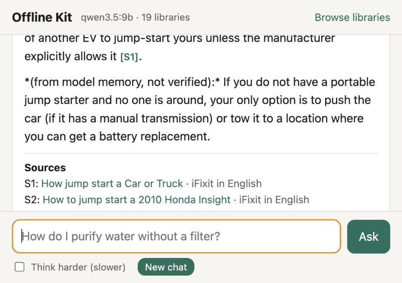

# Offline Emergency Kit

Ask questions and get answers with sources, with no internet.

This kit puts a local AI model and a set of offline libraries on your Mac: Wikipedia,
medicine, first aid, repair guides, water, food, and survival guides. If the internet or
the power grid is down for some days, you can still look things up and solve problems.

It is a small thing for peace of mind. This is the setup that I use. You can use it as is,
or you can give the one prompt below to your AI agent and let it build the same thing for you.



## Principles

1. **Works with no internet.** After the setup, nothing needs a connection.
2. **Stays on your computer.** Every part runs on your Mac and listens only on `127.0.0.1`.
   No account, no cloud, no tracking.
3. **Shows its sources.** The AI first searches the libraries, reads the best articles, and
   then answers. Each answer links to the articles it used. If the libraries do not cover a
   question, the answer says so.
4. **Essentials first.** A core set of about 13 GB lives on the computer. The full Wikipedia
   (about 49 GB) can go on an external drive.
5. **Simple and open.** Open formats (Kiwix ZIM files, open-weight models), plain scripts, no
   build step, no extra packages. You can read all of the code in an hour.
6. **Checks itself.** Every download is checked against its checksum. A self-test asks real
   questions. An optional weekly check looks for a better model for your computer.

## What is inside

| Part | What it does |
|---|---|
| [Ollama](https://ollama.com) | Runs the AI model on your Mac. |
| Model `qwen3.5:9b` (7.6 GB) | Reads the articles and writes the answer. Chosen by a benchmark on this Mac, see [how it works](docs/how-it-works.md). |
| [Kiwix](https://kiwix.org) `kiwix-serve` | Serves the offline libraries and their full-text search. |
| `app/` | The question page and the search-read-answer loop. Python that ships with macOS, no packages. |
| `kit` | One script to install, start, stop, test, and update. |
| `catalog.tsv` | The list of libraries. Edit it to change what you download. |

**The core libraries (about 13 GB):**

- The AI searches and reads: most-read Wikipedia articles, Wikipedia medicine (WikiMed),
  WikEM emergency medicine, iFixit repair guides, Appropedia (practical how-to), Wikivoyage,
  and Wikipedia history, geography, physics, chemistry, cell biology, astronomy, computing,
  and mathematics.
- You read them yourself (PDF guide collections with no search index): post-disaster, water,
  food, field medicine, and knots guides. Open them with **Browse libraries**.

**Optional, for an external drive:** all of English Wikipedia (about 49 GB), films, and a
dictionary.

## What you need

- A Mac with Apple silicon (M1 or newer). Built and tested on a MacBook Pro M3 Pro with 18 GB
  of memory.
- 16 GB of memory or more. With 8 GB, use a smaller model: `./kit use qwen3.5:4b`.
- About 25 GB of free disk space.
- An internet connection for the setup, once (about 21 GB of downloads).

## Get it: two ways

### 1. Use it as is (Mac)

1. Install [Ollama](https://ollama.com/download) and open it once.
2. Get this repository:
   ```bash
   git clone https://github.com/igembitsky/offline-emergency-kit.git
   ```
3. Install, download, and start:
   ```bash
   cd offline-emergency-kit
   ./kit install
   ./kit download core
   ./kit start
   ```
4. The kit opens in your browser at http://127.0.0.1:8091. Ask a question.
5. Run the self-test: `./kit doctor`. Then turn off Wi-Fi and ask one more question.

The downloads take about 20 minutes on a fast connection. If a download stops, run the same
command again. It continues where it stopped.

### 2. Let your agent build it

Give this prompt to Claude Code, Codex, or another coding agent on your computer:

```text
Read https://github.com/igembitsky/offline-emergency-kit: README.md, AGENTS.md and
docs/how-it-works.md. Then set up an offline emergency kit on this computer.

1. Check my hardware (memory, free disk, operating system) and tell me what fits.
2. Read every script before you run it. Tell me what it downloads, from where, and how big.
3. On a Mac with Apple silicon, use the repository as is: clone it, then run ./kit install,
   ./kit download core, ./kit start and ./kit doctor.
   On any other system, rebuild the same design from docs/how-it-works.md for my system.
4. Keep every server on 127.0.0.1. Verify the checksum of every download.
5. Ask me before any download over 1 GB and before you delete anything.
6. At the end, show me how to start and stop it, and help me test one question with the
   network off.
```

## Use it

| To do this | Do this |
|---|---|
| Start | Double-click `Start Offline Kit.command`, or run `./kit start` |
| Stop and free the memory | Double-click `Stop Offline Kit.command`, or run `./kit stop` |
| See what is on | `./kit status` |
| Test it end to end | `./kit doctor` |
| Read the libraries by hand | Press **Browse libraries** in the app |
| Hard question | Tick **Think harder** in the app (slower) |

Each answer takes 35 to 60 seconds on an M3 Pro. The model unloads 5 minutes after the last
question, to give the memory back.

## Keep it up to date

- **Libraries:** every 6 months, while online, run `./kit download core`. `./kit status`
  reminds you when the libraries are more than 6 months old.
- **Model:** run `./kit watch on` to test new models every Monday. The result is in
  `bench/model-watch/status.md`. The watch never switches the model by itself. To switch:
  `./kit use <model>`. The kit tests the new model first and keeps the old one if the test
  fails.
- **Full Wikipedia on an external drive:** make a folder named `offline-kit-library` at the
  top of the drive, then run `./kit download ssd`. The kit uses the drive when it is connected.

## The iPhone companion

Put the most important libraries on your phone too, with the free Kiwix app. Your phone works
when your laptop is off or out of power. Steps: [docs/iphone.md](docs/iphone.md).

## Safety

> [!WARNING]
> - The AI can make mistakes and sound certain. Check the sources it links to.
> - Nothing here is medical advice. In an emergency, contact emergency services if you can.
> - Print the few things you must never be without, such as first-aid steps and contacts.
>   Paper needs no power.

- **Read before you run.** This is a small set of scripts. Read them, or ask your agent to
  read them, before you run them.
- **Local only.** All servers listen on `127.0.0.1`. The app accepts only JSON requests
  addressed to `127.0.0.1` or `localhost`, so other websites cannot use it.
- **Verified downloads.** Libraries are checked against the Kiwix SHA-256 checksums. The Kiwix
  server program is checked against a checksum pinned in `kit`.
- **No secrets.** The kit uses no accounts, keys, or tokens.

To report a security problem, see [SECURITY.md](SECURITY.md).

## License

The code is under the [MIT license](LICENSE). The kit downloads the libraries and the model
from their official sources. They have their own licenses: Wikipedia content is under
CC BY-SA, and the Qwen models are under Apache 2.0. Check each source for its terms.
